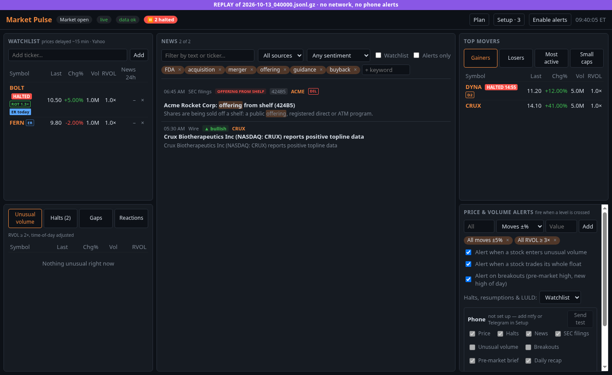
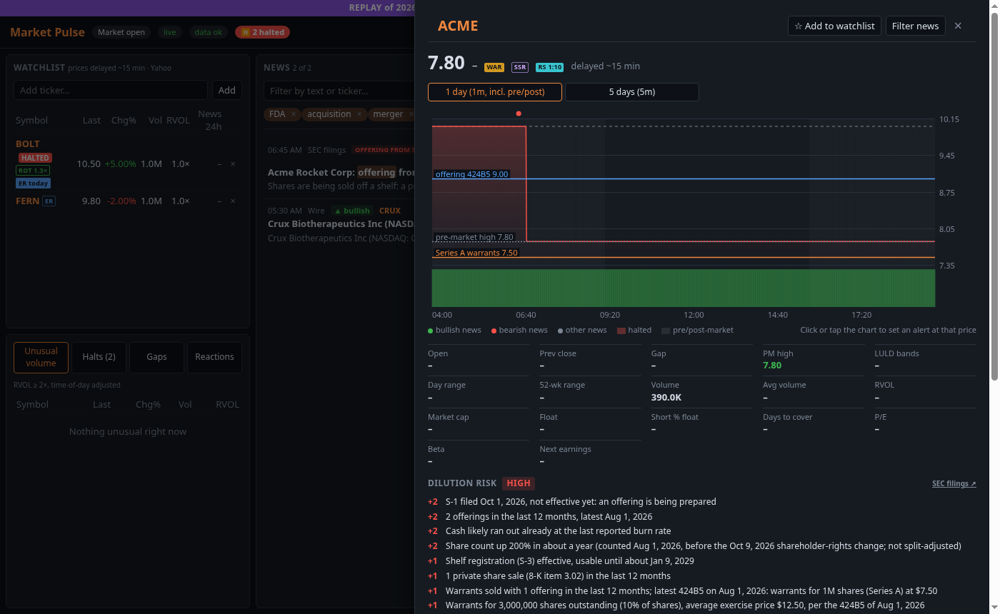
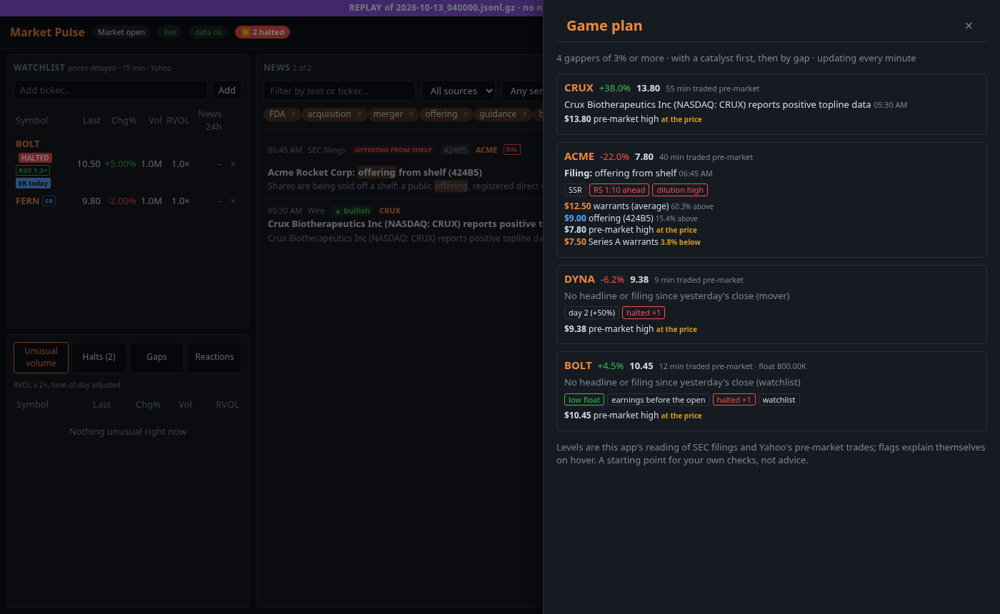

# Market Pulse

A one-screen stock dashboard in the spirit of FoxRunner: live watchlist prices, top movers,
unusual-volume scanner and a real-time news feed with keyword alerts. It uses only free data.
It runs without any API key, and a free Finnhub key adds real-time watchlist prices.



## Run

Requires Python 3.12+ (3.11 works with `pip install -r requirements.txt`, unpinned).

```sh
python -m venv .venv
source .venv/bin/activate        # fish: source .venv/bin/activate.fish
pip install -r requirements.lock # exact versions; requirements.txt is the readable list
uvicorn app.main:app --reload
```

Open http://localhost:8000. The **Setup** panel opens with a checklist: your contact email for
SEC, phone alerts, the background service and the optional extras, each with a button to fix
it. Then click **Enable alerts** to get desktop notifications and a sound.


## What it does

- **Tables**: watchlist, top movers, unusual volume, halts, pre-market gaps and catalyst
  reactions, with badges for what matters to a small-cap trader: halted, dilution risk,
  warrants in the money, short sale restriction, float rotation, reverse split, day 2,
  sympathy, near a LULD band, earnings.
- **News and SEC filings** in one feed, with keyword and watchlist alerts, sentiment, offering
  and warrant terms read from the filings, insider trades, 13D stakes and 8-K events.
- **Ticker panel**: a chart with your alert levels and the filings' price levels (click it to
  set an alert), key stats, the dilution profile, the industry's movers, news and halts.
- **Game plan** (*Plan* in the header): today's gappers, catalyst first, each with everything
  above in one card.
- **Alerts** on the page, the desktop and your phone (ntfy or Telegram): your price rules,
  breakouts, level crossings, halts and resumptions, LULD bands; each kind can be muted, a
  stock snoozed, and the Reactions tab measures how breakouts, level crossings, your rules
  and the other price alerts followed through, and how stocks moved after halts, headlines
  and filings.
- **Your data stays on your computer**: no account, nothing sent anywhere but the data
  sources' own requests, and your alerts to ntfy or Telegram once you set one up. Secrets are
  write-only; a backup never contains one.

| Ticker panel | Game plan |
|---|---|
|  |  |

The screenshots replay a made-up morning with invented companies (`python scripts/screenshots.py`).

## Documentation

- [Running it yourself](docs/getting-started.md): install, first run, phone alerts, the
  background service, phone access, updating, troubleshooting.
- [Using it](docs/using-it.md): a trading day from the pre-market plan to the after-close
  review, and what each badge means.
- [Setting up](docs/setup.md): settings and privacy, real-time prices, phone alerts, the
  background service, record and replay, opening it from your phone, HTTPS, backups.
- [The dashboard](docs/dashboard.md): what's on screen, the ticker panel, the game plan,
  alerts and their noise control, halts and LULD bands, sentiment.
- [Signals, filings and tracking](docs/signals.md): SEC filings and dilution, SSR, float
  rotation, reverse splits, day 2, sympathy, breakouts, gaps, reactions, data health.
- [Code layout](docs/layout.md).

## Limitations

- Without Finnhub, prices are **delayed ~15 minutes**. Movers and volume always are. `yfinance`
  is an unofficial scraper that Yahoo sometimes breaks or rate-limits. Use this for personal
  research, not execution.
- "Unusual volume" only scans the watchlist and the ~100 symbols the screeners return,
  not the whole market.
- Press-release wires publish faster than most news sites, but paid feeds (Benzinga,
  Polygon, etc.) are faster still.
